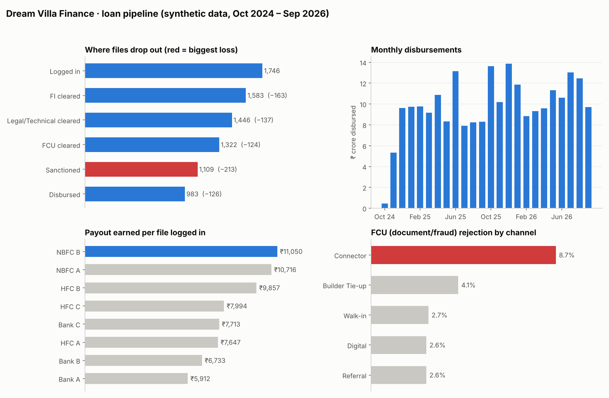

# Loan Pipeline Analytics for a Home-Loan DSA



End-to-end analytics project (Python · SQL · dashboard) built for **Dream Villa Finance**, a loan DSA (Direct Selling Agent) firm in Indore, India, that sources home-loan customers for multiple banks and housing finance companies.

> **Data note:** The firm's customer data is confidential, so this project runs on a **synthetic dataset**. I studied the structure of real sanction letters (fields such as loan amount, tenure, benchmark rate + spread, EMI, processing fee, insurance, and the FI / legal-technical / FCU verification stages) and generated fake data with the same structure. No real customer, lender or number appears in this repository. Lender names are placeholders (Bank A, HFC B, …). The firm can plug its own tracker into the same pipeline internally.

---

## 1. Problem

A DSA earns a payout only when a loan is **disbursed**. Every file that is rejected, withdrawn or stuck costs staff time and earns nothing. The firm wanted to answer five questions:

1. **Funnel:** out of every 100 files logged in, how many get sanctioned and disbursed, and at which stage do most files drop out?
2. **Lenders:** which lenders are worth prioritising once approval rate, turnaround time and payout % are all taken into account?
3. **Sourcing channels:** which channels (builder tie-ups, connectors, walk-ins, referrals, digital) bring files that actually convert?
4. **Trend:** is the business growing, and which months are seasonally strong?
5. **Revenue leakage:** how much payout is lost on files that were sanctioned but never disbursed?

## 2. Data

| Table | Rows | What it holds |
|---|---|---|
| `applications` | 1,800 (after cleaning) | One row per loan file: lender, product, segment, channel, city, stage results, dates, amounts, ROI, EMI, fees, insurance, status |
| `lenders` | 8 | Lender type (Bank / HFC / NBFC) and payout % |
| `properties` | 140 | Project, builder, city, approval status |

- **Period:** Oct 2024 – Sep 2026 (2 years), Indore / Madhya Pradesh region.
- **Funnel stages modelled on real sanction letters:** Login → FI (field investigation) → Legal/Technical → FCU (fraud control / document verification) → Credit → Sanction → Disbursement.
- **EMI** is calculated with the standard reducing-balance formula, which I checked against real sanction letters: it matched two bank letters within ₹1 (banks round the EMI up). One HFC letter differed by about 0.8%, which suggests that lender computes EMI slightly differently.
- **Realistic data-quality issues were injected on purpose**, so the cleaning step has real work to do: duplicate rows, 30 spellings of 6 city names, two date formats, amounts stored as text (`Rs.16,00,000`), inconsistent status labels, missing values and "extra zero" typos.

## 3. Approach

```
src/01_generate_synthetic_data.py   build lenders, properties, applications_raw (messy)
src/02_explore_data.py              profile: shape, types, missing values, duplicates, bad formats
src/03_clean_data.py                fix all issues + add features (days to sanction, payout amount)
src/04_load_to_sqlite.py            load clean tables into SQLite
src/05_run_sql_queries.py           run every query in sql/analysis_queries.sql, save to outputs/
src/06_make_readme_charts.py        dashboard summary image (matplotlib) -> dashboard/summary.png
```

**Cleaning decisions (and why):**
- Duplicates removed by `application_id` (25 rows): the same file was entered twice.
- City names trimmed and title-cased: "INDORE", " indore" and "Indore " are one city.
- Outliers: a lender never sanctions more than was requested, so `sanctioned > requested` flags a typo. 4 rows were corrected and re-checked against the EMI formula (0 mismatches after the fix).
- Missing `sourcing_channel` set to "Unknown" rather than dropping rows. Missing ROI on sanctioned files filled with the median for that lender and segment.
- Blank sanction dates on rejected files are **not** errors (the file never reached sanction), so they are left blank.

**SQL (16 queries):** aggregations with `CASE WHEN`, `JOIN`s across all three tables, `UNION ALL` for the funnel, a subquery for repeat customers, and a `RANK() OVER (PARTITION BY …)` window function for the top lender each month.

## 4. Key findings (on the synthetic data)

These findings come from the synthetic data, so they show what the pipeline surfaces. They are not the firm's real results.

| # | Finding | Number |
|---|---|---|
| 1 | **Overall conversion:** of 1,746 decided files, 63.5% were sanctioned and 56.3% disbursed. | 983 disbursed |
| 2 | **Biggest drop-off is the credit decision:** 213 files were lost between FCU clearance and sanction. Top reasons were high FOIR (51), insufficient income (44) and low CIBIL score (43). | 213 files |
| 3 | **Payout per file vs loan size is a trade-off.** NBFC B earns the firm ₹11,050 per file logged in, against ₹5,912 for Bank A. But Bank A brings the largest disbursed value (₹41.4 Cr) and gives customers the lowest rate (9.12% vs 13.61%). | 1.9× gap |
| 4 | **Connector files fail FCU checks most often:** 8.7% of logins, against 2.6–4.1% for every other named channel. | 8.7% |
| 5 | **Leakage:** 83 files were sanctioned but never disbursed, worth ₹16.2 Cr of loans and ₹10.9 lakh of missed payout. | ₹10.9 L |
| 6 | **Seasonality:** Oct–Nov 2025 logins (100 and 102) were well above the 75-per-month average. | +35% |
| 7 | **Insurance attach rate** is 47% on bank loans, against 73% on HFC loans and 83% on NBFC loans. | 47% vs 83% |

**Caveats I checked:**
- Year 2 logins grew 13.5% (843 → 957), but disbursed files grew only 1% (489 → 494). Part of the gap is that 97 recent files are still in the pipeline: their outcome had not happened when the data ends. Recent periods always look worse until those files close. This is a right-censoring effect, not necessarily a decline.
- Files on "not approved" projects show a *higher* disbursal rate (66.7%) than approved ones. This rests on only 48 files, too few to conclude anything. The generator gives these files a higher rejection chance, so this result is random noise in a small sample.

## 5. Recommendations for the firm

1. **Pre-screen before login.** Check CIBIL and FOIR (existing EMIs ÷ income) before a file is logged in. Credit rejection is the single biggest loss, and these checks take minutes.
2. **Match each customer to the right lender.** Send strong-profile customers to banks, where they get the lowest rate and the firm gets the largest tickets. Send borderline profiles to NBFC/HFC lenders, which approve more often. Do not choose lenders on payout % alone: a customer on a 13.6% rate is less likely to refer friends.
3. **Add a document checklist for connector files.** Connectors bring the second-largest volume but fail FCU checks two to three times as often as other channels. A checklist before login protects the firm's standing with lenders.
4. **Follow up within 7 days of sanction.** Sanctioned files are the cheapest to recover, because the work is already done.
5. **Plan for the festive season.** Line up builder events and staff in September, ahead of the Oct–Nov peak.

## 6. Dashboard

The summary dashboard at the top of this page (`dashboard/summary.png`) shows the funnel drop-off, monthly disbursements, payout per file by lender and FCU rejection by channel. It is built by `src/06_make_readme_charts.py`, and every figure comes from the query outputs in `outputs/`, so it updates when the pipeline is re-run.

## 7. Tools

Python (pandas, NumPy, matplotlib) · SQL (SQLite) · Git

## How to run

```bash
pip install -r requirements.txt
python src/01_generate_synthetic_data.py
python src/02_explore_data.py
python src/03_clean_data.py
python src/04_load_to_sqlite.py
python src/05_run_sql_queries.py
python src/06_make_readme_charts.py
```

The random seed is fixed (`42`), so every run produces the same data and the same numbers.
